# DeskCharm Guide

**Version 1.8.0** · For people who use DeskCharm, and for developers who are new to its code.

DeskCharm hangs a small charm from the top of your screen. Little visitors walk along your taskbar. Gentle tools help you breathe, focus, drink water and take breaks. Everything runs on your own PC.

[[TOC]]

# Part 1 — Using DeskCharm

## 1. What DeskCharm is

DeskCharm is a small desktop companion for Windows.

- **A charm** hangs on a string from the top corner of your screen. It swings when you move past it. You can grab it, fling it, squeeze it and slide its beads.
- **Desk visitors** are small characters (a cat, a baby elephant, Vijay the water buddy and more). Now and then one walks along the top of your taskbar, does a little act and leaves.
- **Calm tools** help you through the day: guided breathing, a focus timer with tasks, break and eye-rest reminders, a water reminder, stretch and posture nudges, a daily mood check-in, a daily ritual, ambient sounds and your own reminders.
- **Insights** show your calm minutes, breaks, water, mood and streak.

> [!NOTE]
> The charm lives in a see-through window that covers your screen. Clicks pass through it to whatever is underneath. Only the charm itself (and visitors, buttons and faces it shows) catch the mouse.

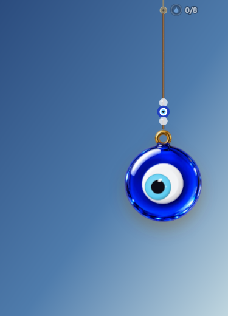

### Privacy in one paragraph

> [!PRIVACY]
> Your settings, tasks, reminders and insights are saved as files on your PC. DeskCharm has no account, no analytics and no tracking. The only times it uses the internet are: the update check (GitHub, every 6 hours), **Live weather wind** if you turn it on (your approximate location from your IP address, then the wind speed from Open-Meteo), and **Quiet during busy calendar events** if you turn it on and paste a calendar link (it downloads that calendar). **Report a problem** opens a pre-filled page in your browser; nothing is sent until you submit it yourself.

### DeskCharm Pro

DeskCharm is free. **DeskCharm Pro** is a one-time **lifetime licence** for your own use on up to 3 PCs. No subscription, no account.

| Free | Pro |
|---|---|
| Nazar and Gods charms, plus one Pro pack free each month | all charm packs, all the time |
| 1 custom charm (your own PNG) | unlimited custom charms |
| all visitors, including festival visitors | **Two charms** (themes as pairs) |
| themes with one charm | Insights full history + **This week** card |
| every calm tool: breathing, focus, breaks, water, posture, mood, reminders, mic-based meeting quiet | **Focus guard** and **Calendar quiet** |
| Insights for the last 7 days | |

- **Trial:** every install gets all of Pro for **7 days**. When it ends nothing is deleted: Pro-only things just switch off or grey out, and come back the moment you add a licence.
- **Price:** ₹69 for launch, then ₹99, one time. The price is in Indian rupees; if your card is from another country, your bank converts it (cards from outside India are coming soon). 7-day no-questions refund.
- **How to buy:** **Settings › General › DeskCharm Pro › Buy Pro** opens **deskcharm.in/pricing.html**. Enter your name, email and phone, then pay with UPI, card or netbanking through Razorpay. Your licence key is shown on the page and emailed to you from **support@deskcharm.in**. Lost it? Use **Find my key** on the website (your email + Razorpay payment id), or email support@deskcharm.in. (A Microsoft Store version may come later.)
- **Enter a licence key:** **Settings › General › DeskCharm Pro › Enter licence key**, paste the key (`DC1-…`) and confirm.

> [!PRIVACY]
> The key is checked **offline** on your PC with a built-in public key. DeskCharm does not contact any server, does not need an account and does not read a hardware id. The key is saved in `license.json` in your DeskCharm folder and included in backups.

## 2. Install, start, update and uninstall

### Install

1. Download the installer (`DeskCharm_1.8.0_x64-setup.exe`) from **deskcharm.in** or the GitHub releases page (github.com/tharuneshwar-s/deskcharm-releases/releases/latest).
2. Run it. It installs for your user only. You do not need administrator rights.

> [!WARNING]
> The build is not signed with a code-signing certificate, so Windows SmartScreen may show **Windows protected your PC**. Click **More info**, then **Run anyway**. To check the file, compare PowerShell `Get-FileHash` with the SHA-256 listed on the release page.

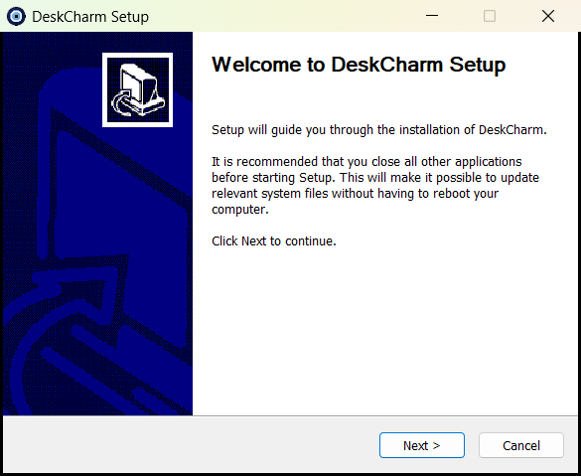

### Start

- DeskCharm starts after installing. The charm appears in the top-right corner.
- The first time, the charm shows three short tips: **Grab me and fling**, **Rest your cursor on me**, **Right-click me**. Each one moves on when you do it. Click the small **×** to skip them.
- DeskCharm runs only once. If you start it again while it is running, the running copy opens **Settings** instead of adding a second charm.
- To start it when you sign in, turn on **Settings › General › Start with Windows**.

### The tray icon

DeskCharm has an icon in the system tray (near the clock).

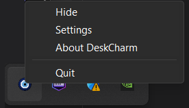

| Action | What happens |
|---|---|
| Left-click the icon | Opens Settings |
| Right-click › **Hide** / **Show** | Hides or shows the charm |
| Right-click › **Settings** | Opens Settings |
| Right-click › **About DeskCharm** | Opens Settings on the General page |
| Right-click › **Quit** | Closes DeskCharm |

> [!TIP]
> **Ctrl+Shift+D** shows or hides the charm from any app. If another app already uses this shortcut, Settings › General says so.

### Update

DeskCharm checks GitHub for a new version when it starts (after about 20 seconds) and then every 6 hours. If one is found, a small cue appears near the charm and **Settings › General › Updates** shows an **Install** button. Nothing is installed until you click it. You can also click **Check now**.

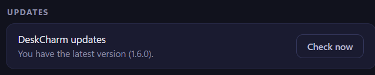

### Uninstall

Open Windows **Settings › Apps › Installed apps**, find **DeskCharm** and choose **Uninstall**.

> [!WARNING]
> The uninstaller also deletes your DeskCharm data folder (`%APPDATA%\com.deskcharm.desktop`) and the start-with-Windows entry. Export a backup first (Settings › General › Backup & logs) if you may come back.

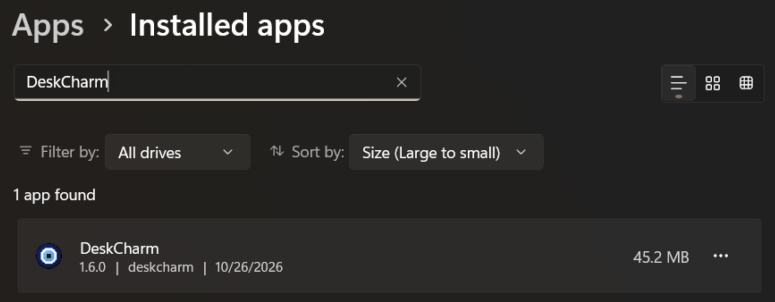

## 3. The charm

### Touch and play

| You do | The charm does |
|---|---|
| Move the cursor past it | Swings (if **Swing when the cursor passes** is on) |
| Grab and drag | Follows your hand; the grabbed spot stays under the cursor |
| Let go while moving | Flies off and swings back (a fling) |
| Press and hold | Squeezes |
| Grab a bead and drag | The bead slides along the string |
| Rest the cursor on it | A soft **breathing glow** (in 4 s, out 6 s). If you set today's intention, it shows here |
| Double-click | Rings a bell |
| Click quickly several times | **Smash to calm**: a ring fills around the charm; when full it bursts into sparkles and a calming chord, and the charm settles |
| Middle-click | Sends a visitor |
| Right-click | Opens the quick menu |
| Fling it round the hook | It winds round the hook and unwinds |

Some features use a single click on the charm too: it ends a break reminder early, answers "Done?" for a focus task, or starts breathing after a low mood or at wind-down time.

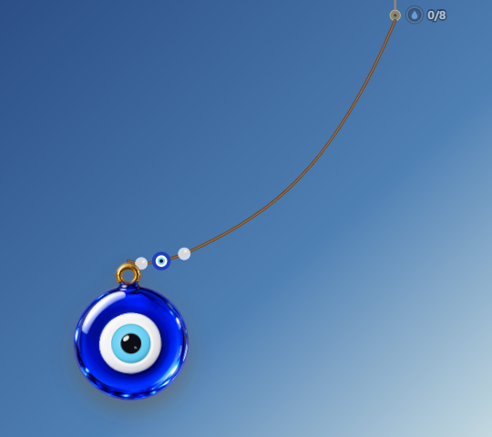

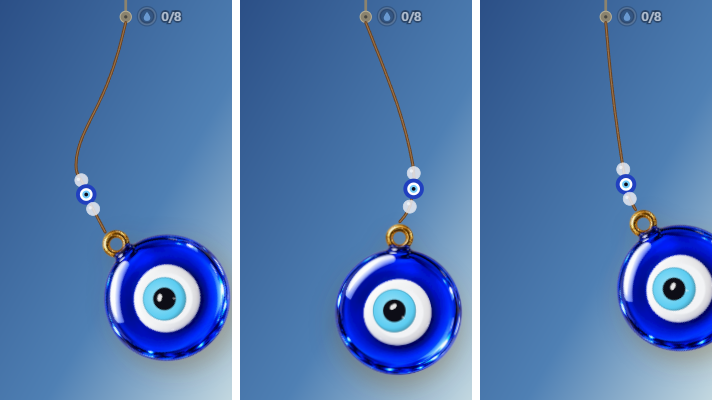

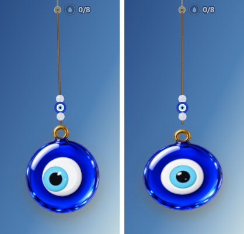

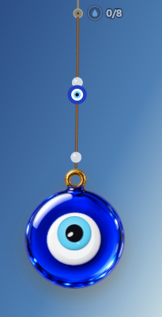

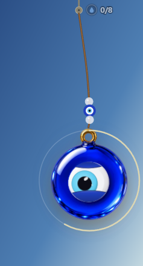

### The quick menu (right-click)

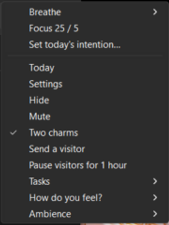

The menu is built fresh each time, so it always matches what is running. From top to bottom:

| Item | What it does |
|---|---|
| **Breathe ▸ 1 min / 3 min / 5 min** | Starts guided breathing. While breathing runs, it is **Stop breathing** instead |
| **Focus 25 / 5** | Starts the focus timer. While it runs, **Stop focus** |
| **Set today's intention…** | Opens Settings so you can type today's intention (only when **Today's intention** is on) |
| **Today** | Shows today's calm summary and streak beside the charm |
| **Settings** | Opens Settings |
| **Hide** | Hides the charm (show it again with Ctrl+Shift+D or the tray) |
| **Mute** / **Unmute** | Turns every DeskCharm sound off or on |
| **Two charms** (tick) | Adds or removes the second charm |
| **Send a visitor** | A visitor walks in now |
| **Pause visitors for 1 hour** / **Resume visitors** | Stops scheduled visitors for an hour |
| **Tasks ▸** | **✔ Done: …** (the current task, during focus), **Focus on a new task…**, and up to a few open tasks (**▶ task**) to start focusing on |
| **How do you feel? ▸** | 😞 Rough · 🙁 Low · 😐 Okay · 🙂 Good · 😄 Great — logs your mood |
| **Ambience ▸** | Off · Rain · Wind · Ocean · Temple · Chimes (ticked = current) |

### One or two charms

You can hang a second charm. Turn it on with **Two charms** in the quick menu, or **Settings › Charm › Charms: Two**. Pick it under the **Charm 2** tab. It can hang **Beside** the first (close enough to clink) or from the **Opposite corner**. It has its own size and string length. If you turn Two on without choosing, DeskCharm picks a partner (Toro gets Kuro).

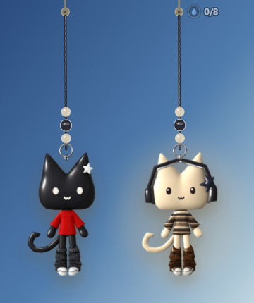

### The living eye and face

With **Living charm** on, eye charms (the nazar family) come alive. The eye follows your cursor, blinks every few seconds, looks dizzy after you spin it round the hook, opens wide after a hard fling, glances at the clock on the hour, and dozes off when you have been away for 5 minutes (1 minute late at night). The cat charms **Toro** and **Kuro** have a living cat face; click them to poke them.

With reduced motion, the eye only blinks and dozes.

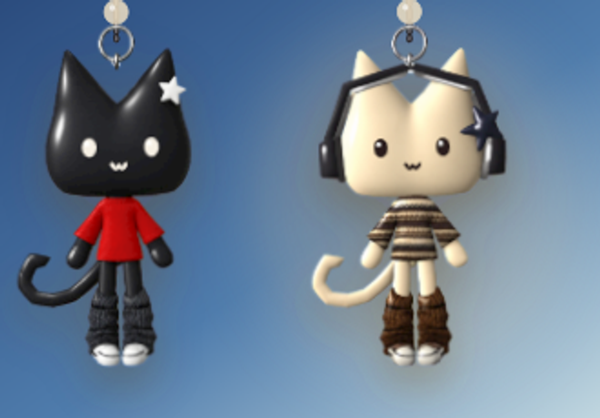

### Charms and themes

The catalog has these families: **Nazar**, **Indian Gods**, **Zodiac**, **Crystals & gems**, **Temple**, **Birthstones**, **Lucky Charms** and **Friends** (cats, animals and Tamil film-star figurines). You can also add your own PNG images (**My charms**).

A **theme** sets both charms, the rope and beads, a soft glow and an ambient sound in one click. There are 10 themes: Temple morning, Rainy focus, Ocean calm, Cosmic, Toro & Kuro, Diwali glow, Garden, Lucky gold, Midnight and Pongal. **Cosmic** asks for your birthday (month and day) to choose your zodiac sign and birthstone.

## 4. Settings tour

Open Settings from the tray icon, the quick menu, or by starting DeskCharm again. Every change saves on its own after a moment; the status at the bottom says **Saved**. The overlay previews changes live.

There are eight pages. Defaults below are what a fresh install uses.

### Charm — "Your charm"

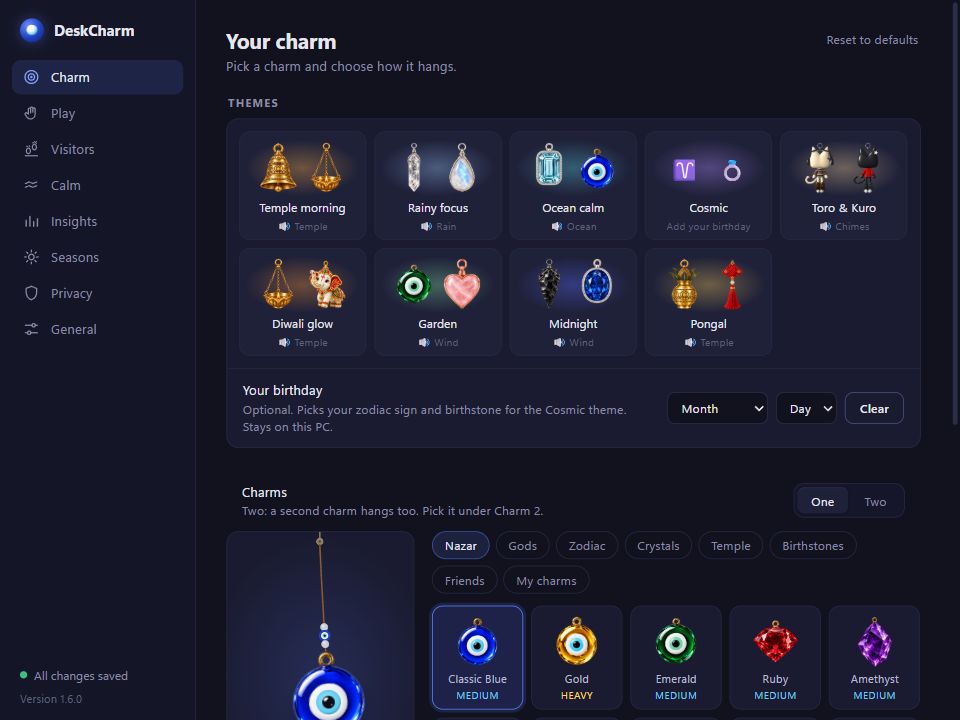

**Themes** (top card)

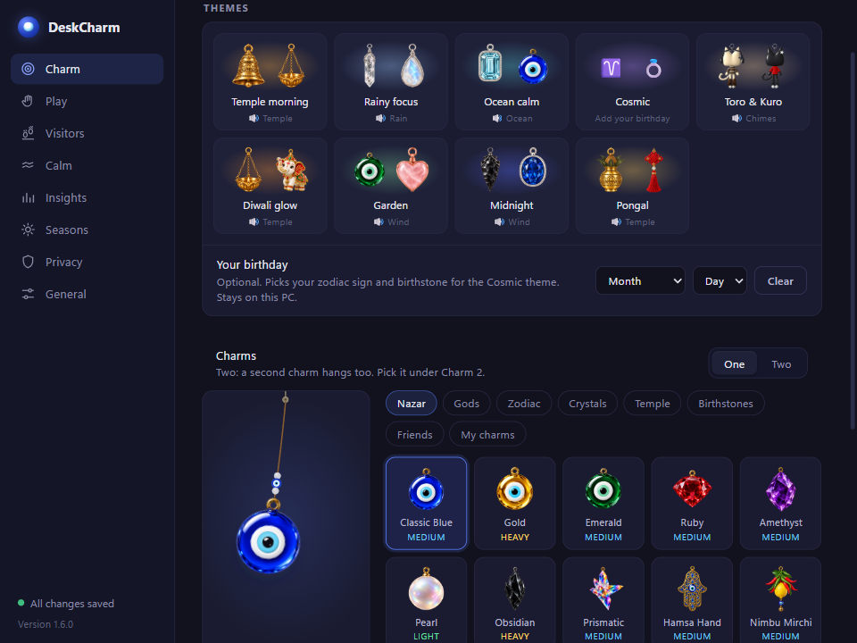

| Option | What it does | Default |
|---|---|---|
| Theme tiles | Apply a theme (charms, rope, glow, ambience) | None |
| Your birthday | Month and day, used by Cosmic | Empty |
| Theme rope & glow › **Use charm's own** | Drops the theme's rope and glow so each charm uses its own | — |

**Charm picker**

| Option | What it does | Default |
|---|---|---|
| **Charms**: One / Two | One charm or two. Two shows **Charm 1** / **Charm 2** tabs | One |
| Category tabs and tiles | Pick a charm. The preview on the side can be dragged | Blue nazar |
| **Add your own** | Choose a PNG; name it; **Delete** removes it (click again to confirm) | — |

**How it hangs**

| Option | What it does | Default |
|---|---|---|
| Side of the screen | Left or Right top corner | Right |
| Charm size | 50–150 % | 100 % |
| String length | 50–150 % | 70 % |
| Opacity | 20–100 % | 100 % |
| Nudge sideways | Move the charm away from the corner (−150 to 150) | 0 |
| Second charm | Beside / Opposite corner | Beside |
| Charm 2 size | 50–150 % | Same as charm 1 |
| Charm 2 string length | 50–150 % | Same as charm 1 |

### Play — "How the charm moves and responds to you"

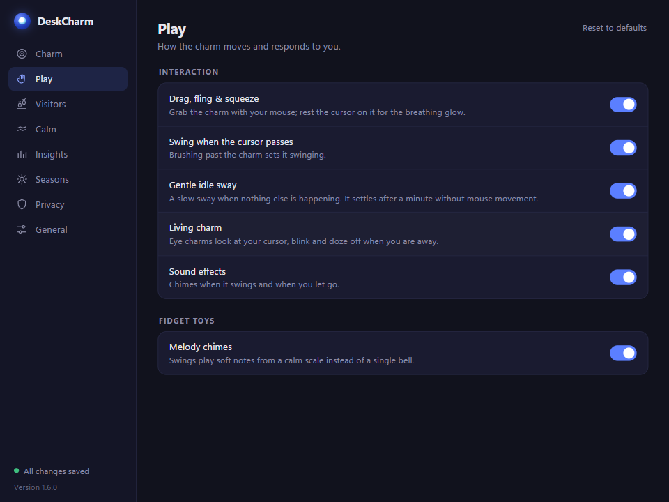

| Option | What it does | Default |
|---|---|---|
| Drag, fling & squeeze | Grab the charm; rest the cursor on it for the breathing glow | On |
| Swing when the cursor passes | Brushing past sets it swinging | On |
| Gentle idle sway | A slow sway; settles after a minute without mouse movement | On |
| Living charm | Eye charms look at you, blink and doze | On |
| Sound effects | Chimes when it swings and when you let go | On |
| **Fidget toys** › Melody chimes | Swings play soft notes from a calm scale instead of one bell | On |

### Visitors — "Desk visitors"

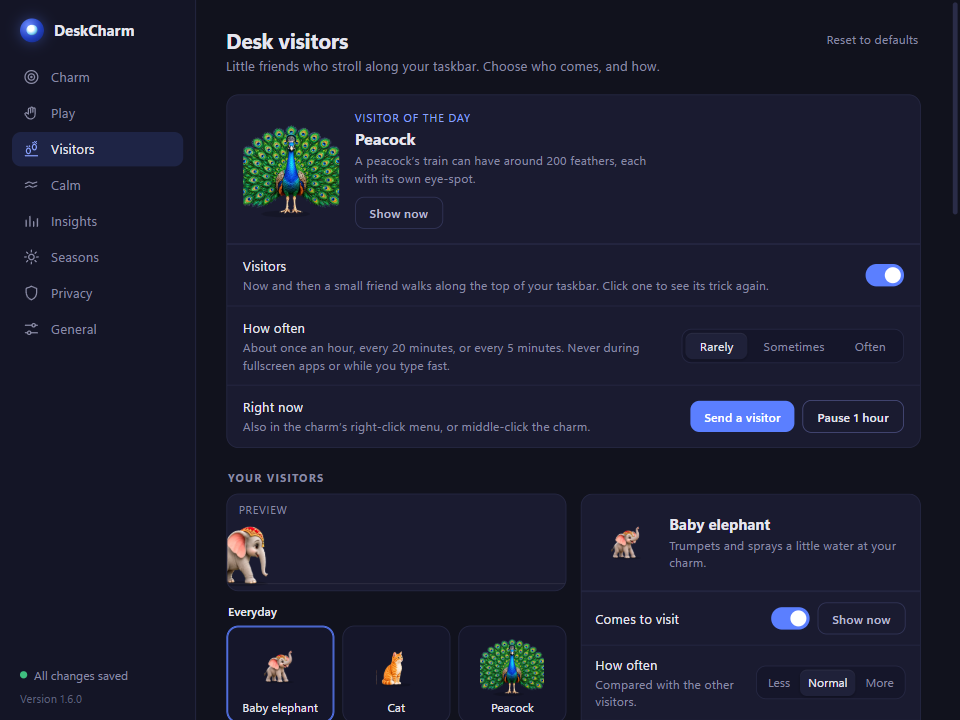

**Top card**

| Option | What it does | Default |
|---|---|---|
| Visitors | Visitors come now and then | On |
| How often | Rarely (about once an hour) / Sometimes (about every 20 min) / Often (about every 5 min) | Rarely |
| Right now | **Send a visitor**, **Pause 1 hour** | — |

The card also shows a **Visitor of the day** with a fun fact.

**Who visits for what** — which visitor comes for each job: water, stretch, posture, break, eye rest, reminders (those set to *Auto*), focus guard, mood cheer, the morning hello and counters.

| Option | What it does | Default |
|---|---|---|
| Who comes | **Auto**: the job's specialist most of the time (Vijay for water, the yogi for stretch and posture, the chai-wala for breaks, the myna for eye rest), and about one visit in four another of your everyday visitors. **Favourite**: one visitor for every job. **Custom** (Pro): pick per job | Auto |
| Favourite | The visitor for every job (only visitors that are switched on) | — |
| Per job (Custom, Pro) | Auto, any visitor that is switched on, or **Charm only** (break, eye rest, reminders, focus guard, mood cheer, morning hello) | Auto |
| Message (Pro) | Your own line for that job, shown exactly as typed; empty = the default line | Empty |
| Try it | Runs that job now (water YES really counts a glass) | — |

Any visitor can do any job. A visitor without its own act for the job walks in, stops and asks the job's question with the job's buttons, and the answer counts the same: YES to water counts a glass, Done on a stretch logs it, *Take it* starts the break, eye rest shows a 20-second countdown. Without Pro, Custom works like Auto (your choices are kept).

**Your visitors** — a gallery grouped as everyday, wellness and festival visitors. Open one to change it just for that visitor:

| Option | What it does |
|---|---|
| Comes to visit (+ **Show now**) | Include this visitor |
| How often | Less / Normal / More |
| Size | Default / S / M / L |
| Trick speed | Slow / Normal / Quick |
| Walks | Default / → / ← / Either |
| Stops at | Default / Left / Middle / Right / Anywhere |
| Sounds, bubbles, tricks, hello, dance, run away | Default / On / Off each |
| Look, name, greeting | Colour variant, a custom name and greeting (where offered) |
| Hello line / Goodbye line (Pro) | What it says when it arrives (replaces the greeting) and as it leaves, exactly as typed |
| Times of day | Morning / Afternoon / Evening / Night — only comes on its own at these times |
| Visits today | How many times it came today, and when last |
| Reset *name* | Back to defaults for this visitor only |

**Defaults for every visitor**

| Option | What it does | Default |
|---|---|---|
| Size | Small / Medium / Large | Medium |
| Walk | Left → right / Right → left / Either | Left → right |
| Stop at | Left / Middle / Right / Anywhere | Middle |
| Sounds | Trumpets, meows and calls (Mute silences them too) | On |
| Speech bubbles | Visitors talk in bubbles | On |
| Charm tricks | Visitors may splash, nudge or borrow a bead | On |
| Reactions | Wave at your cursor, hop to music, run from a flung charm | On |
| Quiet hours | No visitors between two times (you can still send one) | Off, 22:00–07:00 |
| Today | Today's visit log | — |

### Calm — "Breathing, focus and gentle reminders"

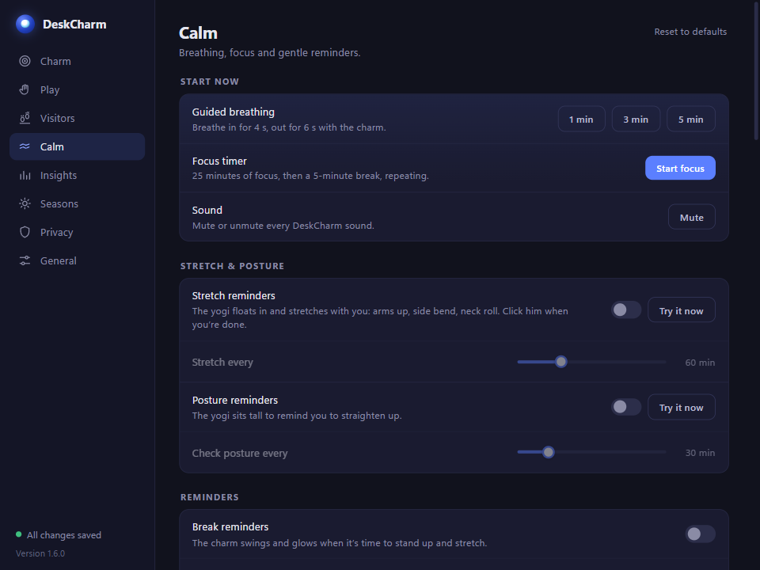

**Start now**: buttons for **Guided breathing** (1 / 3 / 5 min, **Stop breathing**), **Focus timer** (**Start focus** / **Stop focus**) and **Sound** (**Mute** / **Unmute**).

**Reminders**

| Option | What it does | Default |
|---|---|---|
| Break reminders | The charm swings and glows when it is time to stand up; the chai-wala rides in | Off |
| Remind every | 15–120 min | 45 min |
| Eye rest (20-20-20) | Every 20 minutes, look 20 feet away for 20 seconds; the myna bird lands and gazes | Off |
| Water reminder (+ **Try it now**) | Vijay asks you to drink water | On |
| Ask every | 15–180 min | 60 min |
| Daily goal | 4–14 glasses | 8 |
| Your name | What visitors call you | Empty |

**Stretch & posture**

| Option | What it does | Default |
|---|---|---|
| Stretch reminders (+ **Try it now**) | The yogi stretches with you; click him when done | Off |
| Stretch every | 15–180 min | 60 min |
| Posture reminders (+ **Try it now**) | The yogi sits tall | Off |
| Check posture every | 10–120 min | 30 min |

**Mood check-in**

| Option | What it does | Default |
|---|---|---|
| Ask how I feel each day | Once a day, five faces under the charm | On |
| Ask from | At your first activity after this time | 15:00 |

**Daily ritual**

| Option | What it does | Default |
|---|---|---|
| Morning greeting | A chime and "Good morning" at your first activity (from 05:00). With visitors on, a visitor says it | On |
| Today's intention | Shown when you rest the cursor on the charm; cleared at midnight | On |
| Intention for today | One short line | Empty |
| Evening wind-down | A warm glow at the time below; click the charm for 1 minute of breathing | Off |
| Wind down at | Time | 21:30 |
| Weekly reflection | Sunday evening card: calm minutes, breathing, breaks, water, streak, intentions | On |

**Ambience**

| Option | What it does | Default |
|---|---|---|
| Sound | Off / Rain / Wind / Ocean / Temple / Chimes (made live, no recordings) | Off |
| Listen › ▶ Preview | Hear it | — |
| Volume | 0–100 % | 40 % |
| Play during breathing & focus | Starts with a session and fades after; uses Rain if Sound is Off | On |

**Focus tasks**: **Add a task** to a list you can pick from when focus starts.

**Your reminders**: **+ Add reminder**, then **Edit** / **Delete** each one (see chapter 6). Pick a visitor or **Auto** (*Who visits for what*). Tick **Track it** to record each time it is done or missed (3 tracked reminders free, unlimited with Pro).

**Counters**: **+ Add counter** (1 free, unlimited with Pro), then **Edit** / **Delete** (see chapter 6).

| Option | What it does | Default |
|---|---|---|
| Name, emoji | What you count, e.g. Push-ups 💪 (up to 24 characters) | — |
| Daily goal | 1–50 | — |
| Ask every | 15–240 min, only between **From** and **To** (may run past midnight; the same time = all day) | — |
| Who asks | Auto (*Who visits for what* › Counters) or a visitor | Auto |
| Own question (Pro) | Shown exactly as typed instead of "*name*? *emoji*" | Empty |
| Ring | A small ring beside the charm | On |

**Focus guard**

| Option | What it does | Default |
|---|---|---|
| Nudge me back to focus | During focus, a visitor nudges you when a listed app comes to the front | Off |
| Distracting apps | Program file names, e.g. `discord.exe` (**Add**) | Empty |

**Meetings**

| Option | What it does | Default |
|---|---|---|
| Quiet during calls | No visitors while your microphone is in use | On |
| Quiet during busy calendar events | Busy calendar times count as quiet hours | Off |
| Calendar link (.ics) | Your calendar's private iCal address; **Test** checks it | Empty |

### Insights — "Your calm minutes, breaks and streak"

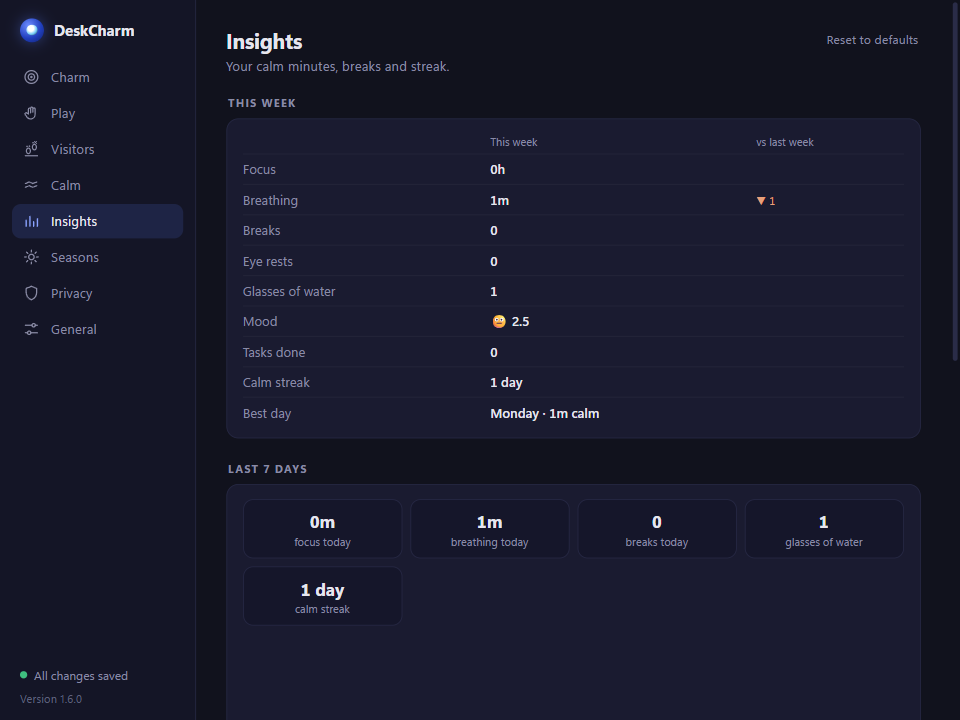

| Card | What it shows / does | Default |
|---|---|---|
| This week | This week against last week (Monday–Sunday) | — |
| Last 7 days | Daily chart, today's calm activity, mood | — |
| Tasks done | Finished focus tasks | — |
| Counters | Each counter's count today against its goal, and the last 7 days as small bars | — |
| Your routines | Each tracked reminder: done today, current streak, the last 7 days as dots | — |
| App usage › Track app usage | Records which apps you use and for how long | Off |
| App usage › Nudge me when I switch apps a lot | Needs app tracking | Off |
| Your data › Delete all insights | Removes every recorded day (**Delete**, confirm) | — |

### Seasons — "Seasons & surroundings"

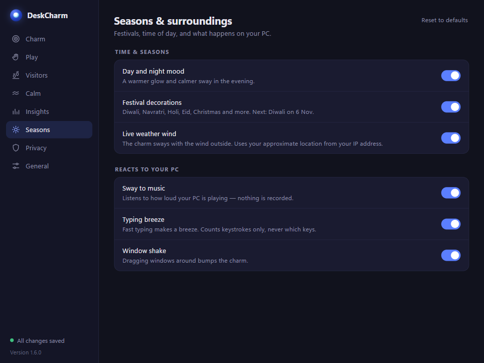

| Option | What it does | Default |
|---|---|---|
| Day and night mood | A warmer glow and calmer sway in the evening | On |
| Festival decorations | Diwali, Navratri, Holi, Eid, Christmas and more; also lets festival visitors come | On |
| Live weather wind | Sways with the real wind outside (approximate location from your IP) | Off |
| **Reacts to your PC** › Sway to music | Follows how loud your PC is playing; nothing is recorded | Off |
| Typing breeze | Fast typing makes a breeze; counts keystrokes, never which keys | Off |
| Window shake | Dragging windows bumps the charm | On |

### Privacy — "Comfort & privacy"

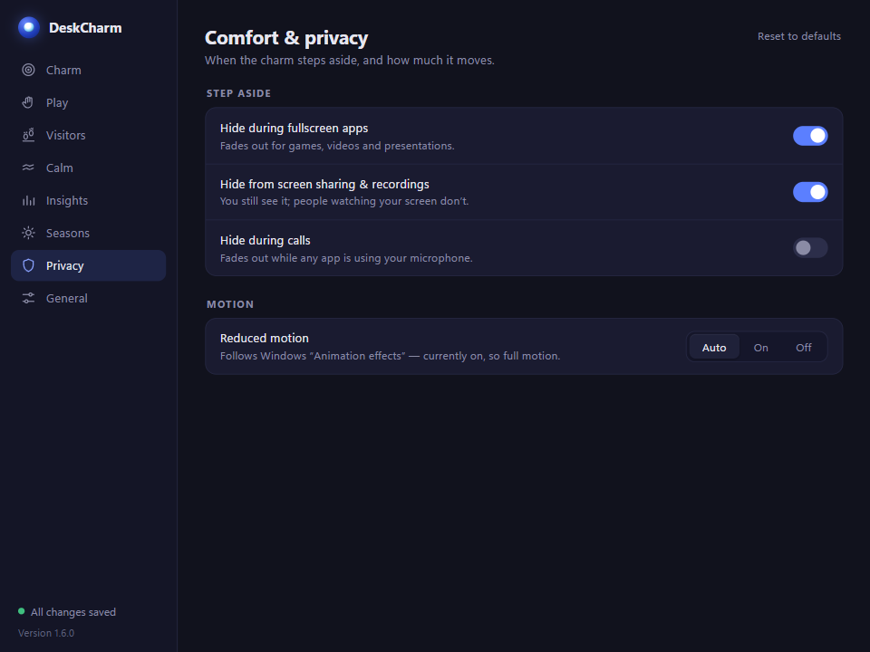

| Option | What it does | Default |
|---|---|---|
| **Step aside** › Hide during fullscreen apps | Fades out for games, videos and presentations | On |
| Hide from screen sharing & recordings | You still see it; people watching your screen do not | On |
| Hide during calls | Fades out while any app uses the microphone | Off |
| **Motion** › Reduced motion | Auto (follow Windows animation setting) / On / Off | Auto |

### General — "Startup, shortcut, updates and about"

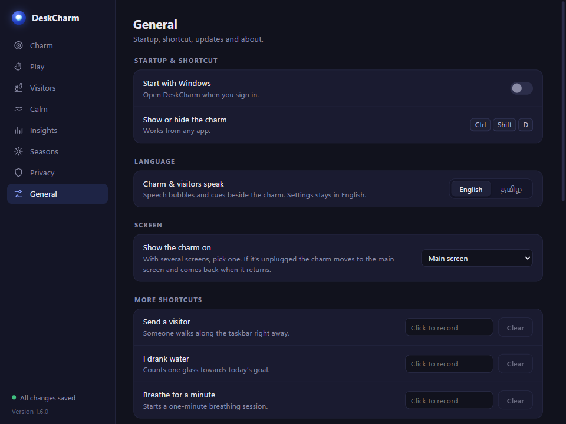

| Section | Option | Default |
|---|---|---|
| Startup & shortcut | Start with Windows; shows whether **Ctrl+Shift+D** works | Off |
| Language | Charm & visitors speak: English / தமிழ் | English |
| Screen | Show the charm on: Main screen or a chosen screen | Main screen |
| More shortcuts | Send a visitor · I drank water · Breathe for a minute (record a key combination; **Clear**) | None |
| Updates | DeskCharm updates: **Check now** / Install | — |
| Backup & logs | **Export settings…**, **Import settings…**, **Open log folder** | — |
| First-run tips | **Show tips** replays the three tips | — |
| Help | **Report a problem…** | — |
| About | Version, links | — |
| Reset | **Reset all** (click again to confirm). Your own charms are kept | — |

If the chosen screen is unplugged, the charm moves to the main screen and returns when it comes back.

## 5. Desk visitors

Visitors walk in along the top of the taskbar, stop, do a short act and walk off. Click a visitor to see its act again. Wave the cursor near one and it says hi. Fling the charm at one and it runs away.

| Visitor | Group | What it does | Click |
|---|---|---|---|
| **Cat** (orange tabby) | Everyday | Stretches with a yawn, sits, licks a paw, gives a slow "cat kiss" blink | Replays |
| **Baby elephant** | Everyday | Trumpets, sprays water at the charm, stomps happily | Replays |
| **Peacock** | Everyday | Turns to you and fans its tail | Replays |
| **Monkey** | Everyday | Stops under the charm, leaps and steals its last bead; it comes back 10 s after he leaves | Gives the bead back at once ("Okay, okay!") |
| **Yogi** | Everyday | Floats in, three slow breaths, namaste. Also does stretch and posture nudges | Nudge: counts it done. Otherwise starts 1 min of breathing |
| **Vijay** | Wellness | The water buddy (below) | Replays |
| **Chai-wala** | Wellness | Rides in on a bicycle, rings the bell, offers chai. Comes only for break reminders | Starts the break |
| **Eye-rest bird** (myna) | Wellness | Lands and gazes far away for about 20 s (20-20-20) | — |
| **Pongal pot carrier** | Festival | The pot boils over, "Pongalo Pongal!" | Replays |
| **Holi colour runner** | Festival | Throws colour, "Bura na mano, Holi hai!" | Replays |
| **Diwali lamp kid** | Festival | Lights a second diya, "Happy Diwali" | Replays |
| **Reindeer** | Festival | Glowing nose, gift pops open, "Merry Christmas!" | Replays |

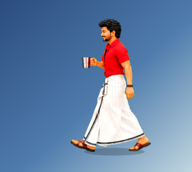

### Festival visitors

Festival visitors come only during their festival and only while **Festival decorations** is on. During a festival about half of all visits are festival visitors.

| Festival | 2026 | 2027 | 2028 |
|---|---|---|---|
| Pongal | 13–16 Jan | 14–17 Jan | 14–17 Jan |
| Holi | 2–4 Mar | 21–22 Mar | 10–11 Mar |
| Diwali | 6–10 Nov | 27–31 Oct | 15–19 Oct |
| Christmas | 24–25 Dec | 24–25 Dec | 24–25 Dec |

Eid, Navratri and New Year have decorations but no visitor.

### When visitors stay away

- **Quiet hours** (if on).
- **Pause visitors for 1 hour**.
- **Quiet during calls** (microphone in use) and **busy calendar events** (if on). Reminders from other features (water, stretch) wait until the call ends.
- When the overlay is hidden (fullscreen apps, calls, Hide).

You can always send one yourself: quick menu, middle-click, Settings, or a shortcut.

### Vijay, the water buddy

Every visit starts with "Vanakkam nanba! 🙏". With the water reminder on, he offers a tumbler: "Hey *name*, drink some water? 💧" with **YES** / **NO**.

- **YES**: "Verithanam 🔥", one glass is counted, he waves bye.
- **NO**: "When should I come back?" — 15 min / 30 min / 1 hour (no choice in 12 s = 20 min). Then he is a little sad.
- No answer in 20 s: he asks again in 20 minutes.

A small ring with a droplet beside the charm's hook shows today's glasses against your goal. It resets each morning. Up to two counters with **Ring** on get their own small rings in the same row (three at most).

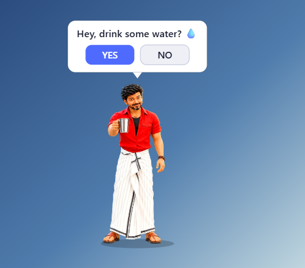

### Visitors as reminders

Your own reminders can bring a visitor, who asks your text with **Done** / **Later**: pick one, or **Auto** to follow *Who visits for what*.

### Who visits for what

Every visitor that comes for a reason (water, stretch, posture, break, eye rest, reminders, focus guard, mood cheer, the morning hello, counters) is chosen in Settings › Visitors › **Who visits for what** (see chapter 4). Visitors that are switched off are never sent; if nobody is available, only the charm's cue shows.

## 6. Calm tools

### Guided breathing

Start it from the quick menu (**Breathe ▸ 1 / 3 / 5 min**), Settings › Calm, or a shortcut. The charm glows: breathe in for 4 seconds, out for 6. A ring and "Breathe in… / Breathe out…" cues guide you. With two charms, both glow.

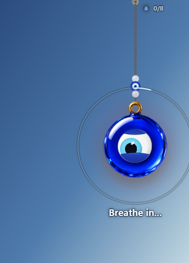

### Focus timer and tasks

**Focus 25 / 5**: 25 minutes of focus, then a 5-minute break, repeating until you stop it. When focus starts, a small window next to the charm asks **What are you working on?** Type a task or pick one from your list (or skip).

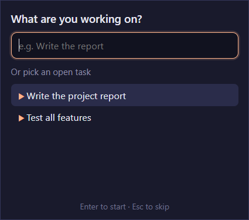

During focus, the charm shows the timer and the task ("24:12 · Write report"). When the focus part ends it asks **Done? Click the charm ✔**. Click = done. Ignore = the task stays open and carries over. Finished tasks appear in Insights › Tasks done. Tasks can be up to 80 characters; up to 200 are kept, finished ones are removed after 30 days, and the quick menu (Tasks ▸) lists up to 6 open ones.

### Break reminders and eye rest

- **Break reminders**: every 45 minutes (by default) of screen time, the charm swings and glows and the chai-wala rides in. Click the charm or him to take the break.
- **Eye rest (20-20-20)**: every 20 minutes, the myna bird lands and gazes far away for 20 seconds. Look at something 20 feet away.

Reminder intervals count only time the charm is visible.

### Water reminder and ring

See *Vijay, the water buddy* above. The **I drank water** shortcut counts a glass without Vijay.

### Stretch and posture

The yogi floats in. Stretch: "Stretch with me 🙆" — arms up, side bend, neck roll. Posture: "Sit tall 🧘". Click him when done ("Nice! 💪"). If you ignore him he asks again after 15 minutes.

### Mood check-in

Once a day at or after the time you set (15:00 by default), at your first activity, the charm asks **How are you feeling?** with five faces under it. It does not ask during focus, breathing, calls, quiet hours or busy calendar time. Ignore it for 60 seconds and it waits until tomorrow. You can also log a mood any time from **How do you feel? ▸**.

- 😞 or 🙁: soft eyes, "Breathe with me?" (click the charm for 1 minute of breathing), and maybe a cheer-up visitor (once a day).
- 🙂 or 😄: a happy eye and a sparkle.

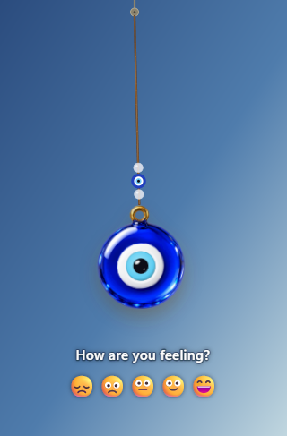

### Daily ritual

Morning greeting, today's intention, evening wind-down and the Sunday weekly reflection card. See Settings › Calm › Daily ritual above.

### Ambience

Rain, wind, ocean, temple or chimes, synthesised live on your PC. It follows **Mute**, fades out when the charm is hidden, and can play automatically during breathing and focus.

### Your reminders

Settings › Calm › **Your reminders** › **+ Add reminder**. Each reminder has a text and a repeat:

| Repeat | Example |
|---|---|
| Daily at a time | Every day at 09:00 |
| On chosen weekdays at a time | Mon, Wed, Fri at 18:30 |
| Every N minutes within a window | Every 90 min from 09:00 to 18:00 (5 min to 12 h) |
| Once at a date and time | 2026-11-02 at 14:00 |

When one is due: a soft chime and your text beside the charm (exactly as typed), a Windows notification, and, if you chose a visitor, that visitor asks with **Done** / **Later**. **Later** asks again in 10 minutes. No answer for 2 minutes: asked once more after 10 minutes. Quiet hours do not apply; during a call it waits until the call ends. If the PC was off: a repeating reminder up to a little late still fires; a one-off fires if it is less than 2 hours late. Use **Test** in the dialog to try it.

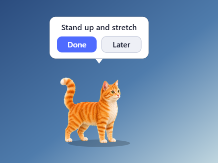

### Tracked reminders and streaks

Tick **Track it** on a reminder and each time it comes due is recorded once. It counts as **done** when you answer Done, even after Later. It counts as **missed** if you ignore it twice, if its next time comes while it is still unanswered, or if it is still unanswered at 23:59; if DeskCharm was closed or your PC slept past the end of the day, it counts as missed on the day it was due. Its streak counts the days on which every time was done; days it wasn't due are skipped, and today counts once it has a Done and no miss. Insights › **Your routines** shows each tracked reminder and This week adds a *Routines done* row. Free: 3 tracked reminders; Pro: unlimited.

### Counters

Count anything you want to do a few times a day: push-ups, prayers, pages read. Within each counter's hours, every *Ask every* minutes a visitor asks "*name*? *emoji*" (or your own question with Pro) with **YES** / **NO**. YES adds one, pulses its ring and shows "*name* *n*/*goal*". NO or no answer asks again after 20 minutes; once the goal is reached it stops asking for the day. Counts go to Insights › **Counters** (today and the last 7 days) and This week. Free: 1 counter; Pro: unlimited.

### Focus guard

Turn on **Nudge me back to focus** and list distracting apps (e.g. `discord.exe`). Only while the focus timer runs, DeskCharm checks the app in front every 2 seconds. If it is on your list, a visitor walks over: "Back to focus? 🎯" — at most once every 5 minutes. Only the program file name is compared; nothing is stored.

### Meeting quiet

**Quiet during calls** keeps visitors away while the microphone is in use. **Quiet during busy calendar events** reads your private iCal (.ics) link every 15 minutes (https only) and treats busy times as quiet hours. **Hide during calls** (Privacy page) hides the charm itself.

## 7. Insights

### What is recorded

Per day, always (it is part of the calm tools):

- Focus minutes and breathing minutes
- Breaks taken and dismissed; eye rests taken and dismissed
- Stress releases (smash to calm)
- Stretches and posture checks finished with the yogi (they count toward your streak and show in **This week**)
- Glasses of water
- Mood check-ins (sum, count and the last one)

Only if you turn on **Track app usage**: the names of apps in front (program or friendly name) with time per day, and app switches per hour. Window titles are never stored.

### Where and how long

Day files live in `%APPDATA%\com.deskcharm.desktop\insights\`, one JSON file per day. DeskCharm keeps today plus the 29 days before it (30 days) and deletes older files on its own.

### How to delete

> [!PRIVACY]
> Settings › Insights › Your data › **Delete all insights**. Uninstalling DeskCharm deletes them too.

The **Today** item in the quick menu shows today's summary and your streak (consecutive days with calm activity).

## 8. Language, shortcuts, backup and help

### Language

Settings › General › Language › **Charm & visitors speak**: English or தமிழ் (Tamil). This changes the speech bubbles and cues on the desktop and the task prompt. The Settings window stays in English. Your reminder texts are shown exactly as you typed them.

### Shortcuts

| Shortcut | What it does |
|---|---|
| **Ctrl+Shift+D** | Show or hide the charm (fixed) |
| Send a visitor | Set your own in Settings › General › More shortcuts |
| I drank water | Counts one glass |
| Breathe for a minute | Starts 1 minute of breathing |

### Backup and restore

Settings › General › Backup & logs:

- **Export settings…** saves every setting and your own charm images into one `.deskcharm` file (default name `DeskCharm settings.deskcharm`).
- **Import settings…** restores it. Any bad field keeps its default.

> [!NOTE]
> Tasks, reminders and insights are not part of the backup.

### Error log

Errors are written to `%APPDATA%\com.deskcharm.desktop\logs\deskcharm.log`. It is capped at 1 MB (one older `deskcharm.log.old` is kept). **Open log folder** opens it. Nothing is sent.

### Report a problem

Settings › General › Help › **Report a problem…** opens a pre-filled GitHub issue in your browser with the version, Windows version and a summary of non-personal settings. Your name, calendar, intention, apps and charm names are left out. Please attach `deskcharm.log`. You can also email **support@deskcharm.in** (Settings › General › About › **Email support**).

## 9. Privacy and your data

All DeskCharm files are in `%APPDATA%\com.deskcharm.desktop\` (for example `C:\Users\you\AppData\Roaming\com.deskcharm.desktop`).

| File or folder | What it holds |
|---|---|
| `config.json` | Every setting (the AppConfig fields in the appendix), including your name, intention, calendar link and focus-guard app list |
| `tasks.json` | Your focus tasks (open and recently finished) |
| `reminders.json` | Your reminders and their repeat rules |
| `insights\YYYY-MM-DD.json` | One file per day of insights (30 days kept) |
| `charms\` | Images you added under **My charms** |
| `logs\deskcharm.log` (+ `.log.old`) | Error log |

> [!PRIVACY]
> A few small things live in the app's web storage (WebView2 `localStorage`): today's water count, and when the mood check-in and daily ritual last ran. The visitor log ("Visits today") is in memory only and is forgotten when DeskCharm closes.

**Network use** (everything else stays on your PC):

| When | Where to | What is sent |
|---|---|---|
| Update check (start + every 6 h) | GitHub Releases | A normal download request |
| Live weather wind (opt-in) | ipwho.is (or ipapi.co), api.open-meteo.com | Your IP address; then the approximate coordinates |
| Busy calendar quiet (opt-in) | Your .ics link | A download request |
| Report a problem | Your browser opens github.com | Only what you submit |

> [!TIP]
> **Hide from screen sharing & recordings** (on by default) also means the charm does not appear in your own screenshots.

## 10. Troubleshooting and FAQ

> [!WARNING]
> **Windows says "Windows protected your PC".** The installer is not code-signed. Click **More info › Run anyway**.

**I can't see the charm.** Press **Ctrl+Shift+D**. Check the tray menu says **Hide** (not **Show**). Fullscreen apps and calls may hide it (Privacy page). If you use several screens, check Settings › General › Screen.

**The charm is not in my screenshot or screen share.** That is **Hide from screen sharing & recordings**. Turn it off on the Privacy page.

**Ctrl+Shift+D does nothing.** Another app has the shortcut. Settings › General shows "Unavailable — another app is using this shortcut."

**Clicks near the charm don't reach my desktop.** Only the charm itself catches the mouse. If you notice otherwise, please report it.

**No visitors come.** Check Visitors is on, quiet hours, **Pause visitors**, calls and calendar quiet. On **Rarely** they come about once an hour. Use **Send a visitor** to test.

**Festival visitors never come.** They only come during their festival dates with Festival decorations on.

**No sound.** Check **Mute** in the quick menu and per-visitor Sounds.

**Start with Windows does nothing (Store version, later).** Turn it on in Windows Settings › Apps › Startup.

**My settings got lost.** Import your backup. If `config.json` is damaged, DeskCharm uses defaults for anything it can't read.

**The charm uses CPU.** When nothing moves, the overlay stops drawing. The idle sway stops after a minute without mouse movement. Turn off Sway to music and Typing breeze if not needed.

**How do I start over?** Settings › General › Reset › **Reset all**.

# Part 2 — Developing DeskCharm

## 11. Tech stack and repo map

| Layer | Technology |
|---|---|
| Desktop shell | Tauri 2 (Rust), WebView2 on Windows |
| Native code | Rust (`src-tauri/src`), crates: serde, parking_lot, chrono, reqwest (rustls), Tauri plugins (single-instance, dialog, global-shortcut, autostart, updater, notification) |
| Overlay and Settings | Plain HTML, CSS and ES modules. No framework, no bundler (`frontendDist` is `src/`) |
| Tests | Node's built-in test runner; `cargo test` |
| Image tools | Node scripts using `sharp` |
| Installer | NSIS (per-user), Tauri updater |

### Repo map

```
amulet/
├─ src/                 Web front end served as-is
│  ├─ index.html        Overlay window page
│  ├─ settings.html     Settings window (pages, ui helpers, core sections)
│  ├─ task-prompt.html  Small "What are you working on?" window
│  ├─ charms.js         Charm catalog (categories, styling, eyes)
│  ├─ themes.js         Themes
│  ├─ *.png             Charm images (600×670)
│  ├─ visitors/         Visitor sprite atlases (<id>-real.webp + .json)
│  ├─ js/               Overlay code (app.js, physics, features, visitors)
│  └─ settings/         Settings sections (one file per area) + settings.css
├─ src-tauri/           Rust app: lib.rs (config, menus, setup) + one module per feature
├─ test/                Node tests (*.test.mjs) and dom.js shim
├─ scripts/             Build helpers (site demo, i18n, sprites, charms, guide)
├─ art/                 Source renders: art/charms, art/visitors/<id>
├─ docs/                Website (GitHub Pages), changelog, QA checklist, this guide
├─ packaging/msix/      Microsoft Store packaging (for later)
└─ .github/workflows/   ci.yml, release.yml
```

### Key files

| File | Purpose |
|---|---|
| `src-tauri/src/lib.rs` | `AppConfig`, config load/save, tray, quick menu, Ctrl+Shift+D, cursor polling, `invoke_handler`, `setup` |
| `src-tauri/tauri.conf.json` | Windows (main, settings), CSP, bundle, updater |
| `src/js/app.js` | Overlay bootstrap, 120 Hz physics loop, render loop, `applyConfig`, `world` |
| `src/js/features.js` | Feature registry |
| `src/js/features/*.js` | One file per feature (wellness, visitors, water, mood, …) |
| `src/js/interaction.js` | Mouse: hover, drag, fling, squeeze, bead slide, clicks, context menu |
| `src/js/rope.js`, `charm.js` | Rope physics and charm drawing |
| `src/js/overlay-ui.js` | Cues, rings, timers beside the charm |
| `src/js/stillness.js` | Decides when the overlay may sleep |
| `src/js/visitors/engine.js` | Visitor registry and runner (header documents a visitor definition) |
| `src/js/visitors/sprite.js` | Sprite-atlas visitors |
| `src/js/i18n.js`, `i18n-ta.js` | `t()` / `tx()` and the Tamil strings |
| `src/js/embed-host.js` | Stand-in for Tauri when the overlay runs in a normal browser |
| `src/js/dev.js` | `DEV` flag for console helpers |
| `src/settings.html` | Settings shell, `DeskSettings.register`, `ui` helpers |

## 12. Architecture

### Windows

| Label | Page | What it is |
|---|---|---|
| `main` | `index.html` | The overlay: transparent, no frame, always on top, not in the taskbar, covers one monitor. Click-through except where the charm is |
| `settings` | `settings.html` | Created on first open. After it has been closed for 5 minutes its webview is destroyed to save memory |
| `task-prompt` | `task-prompt.html?lang=` | Tiny always-on-top window by the charm when focus starts (the overlay cannot take typing) |

### Click-through

The overlay starts with `setIgnoreCursorEvents(true)`. Rust polls the cursor every 8 ms and sends `cursor-pos` [x, y] in overlay CSS pixels. `app.js` hit-tests the charms, visitors and UI and turns cursor events on only while the cursor is over something clickable.

### Rust ↔ JS: important events

| Event | Direction | Payload / meaning |
|---|---|---|
| `request-config` | JS → Rust | Ask for the config; Rust answers `current-config` |
| `current-config` | Rust → JS | Full `AppConfig` |
| `save-config` | Settings → Rust | Full config to save |
| `config-changed` | Rust → JS | Saved config broadcast |
| `config-save-result` | Rust → Settings | `true` / `false` (drives "Saved") |
| `preview-config` | Settings → overlay | Live preview before saving |
| `cursor-pos` | Rust → overlay | `[x, y]` |
| `show-quick-menu` | overlay → Rust | Right-click on the charm |
| `wellness-command` / `wellness-state` | Rust → overlay / overlay → Rust | Breathe, focus; what is running |
| `visitor-command` | Rust/Settings → overlay | `{ action: 'send', id? }`, `pause`, `resume` |
| `visitor-job-command` | Settings → overlay | Try it: `{ job, id?, message? }` runs that job now through its feature |
| `desk:visitor-job` (window) | overlay features → `features/visitors.js` | `{ job, id?, data?, onAnswer? }`: one resolver (`src/js/visitor-jobs.js` `visitorFor`) picks the visitor; specialists keep their acts, others run the generic act (`src/js/visitors/jobs.js`); sets `detail.sent` / `detail.visitor` |
| `visitor-visited` | overlay → Rust | Visit log entry |
| `water-command` | → overlay | `{ action: 'ask' }` or `'drank'` |
| `nudge-command` | Settings → overlay | `{ kind: 'stretch' \| 'posture' }` |
| `insights-event` `{ kind: 'counter', id }` | overlay → Rust | One YES for a counter (`Day.counters`); tracked reminders are recorded by `reminders.rs` (`Day.reminders`) |
| `insights-event` | overlay → Rust | `{ kind, minutes? }` |
| `insights-today`, `insights-nudge` | Rust → overlay | Today card, switch nudge |
| `mood-log` / `mood-command` | overlay → Rust / Rust → overlay | Mood check-in |
| `task-prompt`, `task-chosen`, `task-current`, `task-command` | both | Focus tasks |
| `reminder-due` / `reminder-ack` | Rust → overlay / overlay → Rust | Your reminders |
| `env-call`, `env-busy`, `env-distraction` | Rust → overlay | Microphone in use, calendar busy, focus guard |
| `env-audio-level`, `env-typing-rate`, `env-window-move` | Rust → overlay | Reacts to your PC |
| `smart-hide`, `system-motion` | Rust → overlay | Fullscreen/call hiding; Windows animations setting |
| `onboarding-done` | overlay → Rust | First-run tips finished |
| `update-available`, `open-settings` | Rust → overlay / overlay → Rust | Update cue |
| `hotkey-status`, `settings-opened`, `show-about-tab` | Rust → Settings | Shortcut state, focus Settings |

### Commands (`invoke`)

All in one `invoke_handler` in `lib.rs` (a second call would replace it):

| Area | Commands |
|---|---|
| Config | `config_defaults`, `open_link` |
| Custom charms | `custom_charms_dir`, `add_custom_charm`, `delete_custom_charm` |
| Insights | `insights_day`, `insights_range`, `insights_clear` |
| Updates | `update_status`, `update_check`, `update_install` |
| Tasks | `tasks_list`, `tasks_add`, `tasks_complete`, `tasks_delete`, `tasks_summary` |
| Reminders | `reminders_get`, `reminders_set`, `reminder_test` |
| Other | `app_platform`, `wellness_state`, `visitor_log`, `log_js_error`, `open_log_folder`, `export_settings`, `import_settings`, `calendar_test`, `list_monitors` |

### Config flow

1. Rust loads `config.json` into `AppConfig` (`#[serde(default)]`, so missing fields get defaults), then `normalized()`.
2. The overlay and Settings emit `request-config`; Rust replies `current-config`.
3. Overlay: `applyConfig(cfg)` in `app.js` applies the core fields and calls every feature's `onConfig(cfg, world)`.
4. Settings: each section's `apply(cfg)` fills its controls. On any change, Settings builds the config by calling every section's `collect(out)`, sends `preview-config` after 30 ms, and `save-config` after 450 ms.
5. Rust saves (atomic write), applies autostart, hotkeys and monitor, then emits `config-changed`.

Quick-menu toggles (Mute, Two charms) change the Rust state directly and emit `current-config`.

### The overlay loop and sleep

`app.js` runs physics at a fixed 120 Hz step and renders once per animation frame. To keep idle CPU near zero, the loop stops when nothing can change. `stillness.js` decides (pure, tested): ropes at rest, cursor quiet for 1 s, no `keepAwake` deadline. Idle sway turns off after 60 s without mouse input so the overlay can sleep. Any config, event or input wakes it. A feature that animates must call `world.keepAwake(ms)`.

### Features registry

```js
import { registerFeature } from '../features.js';
registerFeature({
  onInit(world) {},           // once, before the first frame
  onConfig(cfg, world) {},    // every config / preview (cfg may be partial)
  onStep(world) {},           // each 120 Hz physics step
  onRender(world, now, dt) {} // each frame
});
```

Each feature file is imported once from `app.js`. `world` holds `charms`, `layers` (back, charms, front, ui), `interaction`, `config`, `emit`, `listen`, `hidden`, `reducedMotion`, `keepAwake` and more.

### Overlay UI

`overlay-ui.js` draws cues (short text), progress rings and timers beside the charm. `OverlayUI.setCue` passes text through `t()`.

### Language (i18n)

- `t(text, vars)` translates when shown: `t('{n}/{goal} glasses today 💧', { n, goal })`.
- `tx(text)` only marks a string for the extractor (returns it unchanged); translate later with `t()`.
- Tamil strings live in `src/js/i18n-ta.js` (English → Tamil).
- `node scripts/i18n-strings.mjs` lists overlay strings missing in Tamil; `--check` fails if any (tested by `npm test`).

## 13. How to …

### Run in development

```
npm install
npx tauri dev
```

> [!NOTE]
> The dev build serves from `127.0.0.1`, so `DEV` is true and console helpers exist.

### Debug

- Open the overlay's DevTools: start with `WEBVIEW2_ADDITIONAL_BROWSER_ARGUMENTS=--remote-debugging-port=9333` and open `http://localhost:9333` in Edge/Chrome.
- Console helpers (dev only, from `DEV` in `src/js/dev.js`): `DeskVisitors` (`send`, `list`, `inQuietHours`, `greet` …), `DeskWater.now()`, `DeskNudges.now()`, `DeskReminders.fire()`, `DeskTips.start()`, `DeskRitual`, `DeskLiving`, `DeskSeasons.previewFestival('holi')` / `previewHour(21.5)`.
- Without Tauri: serve `src/` with any static server and open `index.html?embed&visitors` (visitors on). `DeskEmbed.fire('preview-config', {...})` applies config. `index.html?festival=diwali` previews a festival. `settings.html` opens without Tauri (events do nothing).

### Add a charm

1. Add an entry to a category in `src/charms.js` (`id`, `name`, `image`, `weight`, rope and bead styling; optional `eye` for a living eye).
2. Make the art (`src/CHARM-ART.md`, "Producing the art"): render on flat chroma green (magenta if the subject has green), split sheets with `node scripts/charms/split-sheet.mjs`, cut out with `node scripts/charms/cutout.mjs <render> src/<id>.png [green|magenta]` → 600×670 PNG, ring top at y≈8.
3. Keep sources in `art/charms/`; run `node scripts/sprites/compress.mjs art/charms`.
4. Check it on dark and light backgrounds.

### Add a visitor

1. Read the header of `src/js/visitors/engine.js` (definition fields: `id`, `name`, `group`, `fact`, `act`, `hit`, `onClick`, `festival`, `cueOnly` …).
2. Realistic visitors use `sprite.js` (see `vijay.js`): render poses on green in `art/visitors/<id>/` with a `sprites.json` spec.
3. Pack: `node scripts/sprites/pack.mjs art/visitors/<id>/sprites.json` → `src/visitors/<id>-real.webp` + `.json`.
4. Compress sources: `node scripts/sprites/compress.mjs art/visitors/<id>`.
5. Create `src/js/visitors/<id>.js` calling `registerVisitor(...)` and import it where the others are imported.
6. Wrap bubble text for `t()` and add Tamil entries.

### Add a feature

1. `src/js/features/<name>.js` with `registerFeature({...})`; one `import './features/<name>.js';` in `app.js`.
2. Config field in `AppConfig` (`lib.rs`) **and** its default in `impl Default`. Old configs keep working thanks to `#[serde(default)]`.
3. Settings section: `src/settings/<name>.js` with `DeskSettings.register`, plus a `<script>` tag near the end of `settings.html`.
4. Native part (if needed): a Rust module `src-tauri/src/<name>.rs` with `listen`/`init`, and for menu items `insert_menu_items`/`append_menu_items` + `on_menu` with a `MENU_PREFIX` (see `wellness.rs`). Wire it in `lib.rs` (mod, setup, `on_menu_event`, commands).
5. Overlay strings via `t()` / `tx()` with Tamil entries in `i18n-ta.js`.
6. Tests for real logic (pure functions, schedules) in `test/` and `#[cfg(test)]`.

### Add a Settings section

```js
window.DeskSettings.register({
  page: 'calm',            // charm | play | visitors | calm | insights | seasons | privacy | general
  order: 40,               // position on the page
  label: 'My section',
  render(body, ui) {
    this.t = ui.toggle(body, 'Do the thing', null, 'One-line explanation.');
  },
  apply(cfg) { this.t.set(cfg.my_field); },
  collect(out) { out.my_field = this.t.get(); },
});
```

> [!TIP]
> Helpers: `ui.toggle`, `ui.slider`, `ui.segmented`, `ui.row` (→ `{ row, control, setDesc }`), `ui.button(parent, text, 'primary'|'ghost'|'danger', onClick)`. Check an existing section (e.g. `settings/wellness.js`) for the exact control API.

## 14. Testing

| Check | Command | What it covers |
|---|---|---|
| JS tests | `npm test` | `node --test "test/*.test.mjs"`; import `test/dom.js` first for a minimal DOM |
| Syntax | `node --check <file>` | Every JS file you touch |
| Rust tests | `cargo test --lib` (in `src-tauri`) | Config compatibility, reminders, calendar, tasks, logs … |
| Tamil strings | `node scripts/i18n-strings.mjs` | 0 missing |
| Demo sync | `node scripts/build-site-demo.mjs --check` | `docs/demo` matches `src` |

**CI** (`.github/workflows/ci.yml`) runs on push to master and pull requests, on Windows, macOS and Linux: `node --check` on all front-end files, `npm test`, demo check (Linux), `cargo check --locked`, `cargo test --locked --lib`.

> [!NOTE]
> **Manual QA**: `docs/QA.md` is the checklist to run on the installed build before every release.

> [!TIP]
> **Visual checks**: serve `src/` statically and open `index.html?embed&visitors` or `settings.html` in headless Edge (`msedge --headless=new`) to take screenshots. Look at every one.

## 15. Building and releasing

- `npm run build` (= `tauri build`) makes the NSIS installer in `src-tauri/target/release/bundle/nsis/`.
- Updater artifacts are signed. Set `TAURI_SIGNING_PRIVATE_KEY` (and `TAURI_SIGNING_PRIVATE_KEY_PASSWORD`) before building; the public key is in `tauri.conf.json`. Keep the private key safe — without it, installed copies cannot update.
- **Release workflow** (`release.yml`): pushing a tag `v*` builds, signs and creates a draft GitHub release with `latest.json`. Installed copies see the update only after the draft is published.

**Version bump** — change all of these:

| File | Where |
|---|---|
| `package.json` | `"version"` |
| `src-tauri/tauri.conf.json` | `"version"` |
| `src-tauri/Cargo.toml` | `version` (Cargo.lock follows) |
| `src/settings.html` | `var VERSION` and the `Version x.y.z` label |

Then update `docs/changelog.html`, run `node scripts/build-site-demo.mjs` so the website demo (`docs/demo`) matches, and update the website pages in `docs/` if features changed. Run `docs/QA.md`.

## 16. Conventions and gotchas

- **Click-through**: the overlay ignores the mouse except over hit areas. New clickable things need a hit area, or clicks fall through to the desktop.
- **Capture exclusion**: with **Hide from screen sharing** on (default), screenshots and screen recorders do not show the overlay. Turn it off for screenshots.
- **Release builds use `panic = "abort"`**: a Rust panic closes the app. Avoid `unwrap()` on anything that can fail. The panic hook writes it to the log first.
- **`keepAwake`**: the overlay sleeps when still. Animations must call `world.keepAwake(ms)` or they freeze.
- **Green vs magenta keying**: art with green in it must be rendered on magenta.
- **Config compatibility**: never rename or remove an `AppConfig` field; add new ones with a default. Tests check that `{}` and old configs load.
- **One `invoke_handler`**: add commands to the existing list.
- **Shared files** (`lib.rs`, `settings.html`, `app.js`, `i18n-ta.js`): keep edits small.
- **Overlay strings**: always `t()` / `tx()` with a Tamil entry; reminder texts are shown as typed.
- **Reduced motion**: read `world.reducedMotion` and offer a calm version (fade instead of move).
- **Privacy**: no analytics; any new network use must be opt-in and listed in the CSP `connect-src`.
- **Single instance**: a second launch opens Settings; test with the installed build.

## 17. Roadmap and glossary

See `ROADMAP.md` for plans and `docs/changelog.html` for what shipped.

| Term | Meaning |
|---|---|
| Overlay | The transparent always-on-top window with the charm |
| Charm | The swinging object on a string |
| Nazar | The blue eye charm that wards off the evil eye |
| Visitor | A small character walking on the taskbar |
| Quick menu | The charm's right-click menu |
| Feature | A JS module registered with `registerFeature` |
| Section | A Settings card registered with `DeskSettings.register` |
| Cue | Short text shown beside the charm |
| Quiet hours | Times with no scheduled visitors |
| Smart hide | Fading out for fullscreen apps or calls |
| Embed | Running the overlay in a normal browser page (`?embed`) |
| Atlas | A WebP grid of pre-rendered visitor poses |

# Appendix — AppConfig fields

All fields of `AppConfig` in `src-tauri/src/lib.rs`, saved in `config.json`.

| Field | Default | Meaning |
|---|---|---|
| `position` | `"top-right"` | Corner the charm hangs from (`top-left` / `top-right`) |
| `idle_animation` | `true` | Gentle idle sway |
| `cursor_interaction` | `true` | Swing when the cursor passes |
| `sound_effects` | `true` | Sounds on (false = muted) |
| `auto_start` | `false` | Start with Windows |
| `opacity` | `1.0` | Charm opacity |
| `theme` | `""` | Applied theme id (`""` = none / customised) |
| `charm_style` | `null` | Theme rope and bead style over both charms |
| `accent_glow` | `""` | Theme glow colour `#rrggbb` |
| `birth_date` | `""` | Birthday `MM-DD` (Cosmic theme) |
| `charm_size` | `100` | Charm size % |
| `string_length` | `70` | String length % |
| `charm` | `"nazar-blue"` | Main charm id |
| `charm_data` | `null` | Main charm's catalog data |
| `offset` | `0` | Nudge sideways (px) |
| `drag_interaction` | `true` | Drag, fling & squeeze |
| `second_charm` | `""` | Charm 2 id (remembered when off) |
| `second_charm_data` | `null` | Charm 2 data |
| `charm_count` | `0` → `1` | 1 or 2 charms (0 = unset, normalised to 1) |
| `second_place` | `"beside"` | `beside` / `opposite` |
| `second_size` | `0` → charm size | Charm 2 size % (0 = copy main) |
| `second_length` | `0` → string length | Charm 2 string % (0 = copy main) |
| `melody_chimes` | `true` | Melody chimes |
| `break_reminders` | `false` | Break reminders |
| `break_interval_min` | `45` | Minutes between breaks |
| `eye_rest` | `false` | 20-20-20 eye rest |
| `music_sway` | `false` | Sway to music |
| `typing_breeze` | `false` | Typing breeze |
| `window_shake` | `true` | Window shake |
| `day_night` | `true` | Day and night mood |
| `festival_themes` | `true` | Festival decorations and visitors |
| `weather_wind` | `false` | Live weather wind |
| `custom_charms` | `[]` | Your charms `{ id, name, file, weight }` |
| `hide_fullscreen` | `true` | Hide during fullscreen apps |
| `hide_from_capture` | `true` | Hide from screen sharing & recordings |
| `hide_during_calls` | `false` | Hide during calls |
| `reduced_motion` | `"auto"` | `auto` / `on` / `off` |
| `app_tracking` | `false` | Track app usage |
| `switch_nudges` | `false` | Nudge on frequent app switching |
| `visitors` | `true` | Visitors on |
| `visitor_frequency` | `"rare"` | `rare` / `sometimes` / `often` |
| `visitor_size` | `"m"` | `s` / `m` / `l` |
| `visitor_direction` | `"ltr"` | `ltr` / `rtl` / `random` |
| `visitor_stop` | `"center"` | `left` / `center` / `right` / `random` |
| `visitor_sounds` | `true` | Visitor sounds |
| `visitor_bubbles` | `true` | Speech bubbles |
| `visitor_tricks` | `true` | Charm tricks |
| `visitor_reactions` | `true` | Reactions |
| `visitor_quiet` | `false` | Quiet hours on |
| `visitor_quiet_from` | `"22:00"` | Quiet hours start |
| `visitor_quiet_to` | `"07:00"` | Quiet hours end |
| `visitor_prefs` | `{}` | Per-visitor overrides (only what differs) |
| `water_reminder` | `true` | Water reminder |
| `water_interval_min` | `60` | Minutes between asks |
| `water_goal` | `8` | Glasses per day |
| `user_name` | `""` | What visitors call you |
| `onboarding_done` | `false` | First-run tips shown |
| `living_charm` | `true` | Living eye / face |
| `ambience` | `"off"` | `off` / `rain` / `wind` / `ocean` / `temple` / `chimes` |
| `ambience_volume` | `40` | 0–100 |
| `ambience_with_sessions` | `true` | Ambience during breathing & focus |
| `ritual_greeting` | `true` | Morning greeting |
| `ritual_intention` | `true` | Today's intention |
| `daily_intention` | `null` | `{ day: "YYYY-MM-DD", text }` |
| `ritual_winddown` | `false` | Evening wind-down |
| `ritual_winddown_time` | `"21:30"` | Wind-down time |
| `ritual_weekly` | `true` | Weekly reflection |
| `stretch_reminders` | `false` | Stretch reminders |
| `stretch_interval_min` | `60` | Minutes between stretches |
| `posture_reminders` | `false` | Posture reminders |
| `posture_interval_min` | `30` | Minutes between posture checks |
| `focus_guard` | `false` | Focus guard |
| `focus_guard_apps` | `[]` | Distracting exe names |
| `visitors_quiet_in_calls` | `true` | Quiet during calls |
| `calendar_quiet` | `false` | Quiet during busy calendar events |
| `calendar_ics_url` | `""` | Private .ics link |
| `hotkey_visitor` | `""` | Shortcut: send a visitor (`""` = off) |
| `hotkey_water` | `""` | Shortcut: I drank water |
| `hotkey_breathe` | `""` | Shortcut: breathe for a minute |
| `ui_language` | `"en"` | `en` / `ta` |
| `monitor` | `""` | Screen name (`""` = main screen) |
| `mood_checkin` | `true` | Daily mood check-in |
| `mood_time` | `"15:00"` | Ask from this time |
| `visitor_mode` | `"auto"` | Who visits for what: `auto` / `favourite` / `custom` (Pro; free = Auto) |
| `visitor_favourite` | `""` | Favourite visitor id (`""` = Auto) |
| `visitor_jobs` | `{}` | Custom: `{ job: id \| "auto" \| "charm" }`; jobs `water`, `stretch`, `posture`, `break`, `eye_rest`, `reminder`, `focus_nudge`, `mood_cheer`, `greeting`, `counter` |
| `visitor_job_messages` | `{}` | Pro: `{ job: text }` shown as typed |
| `visitor_lines` | `{}` | Pro: `{ visitor id: { hello, bye } }` shown as typed |
| `counters` | `[]` | `[{ id, name, emoji, goal, every_min, from, to, visitor, message, ring }]` (1 free, unlimited with Pro) |
